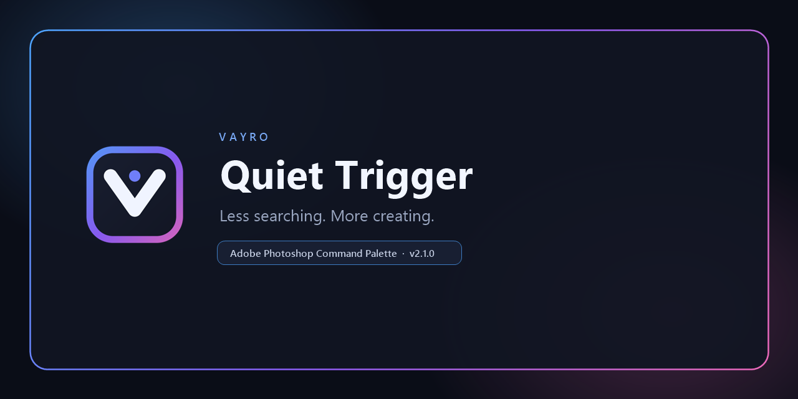
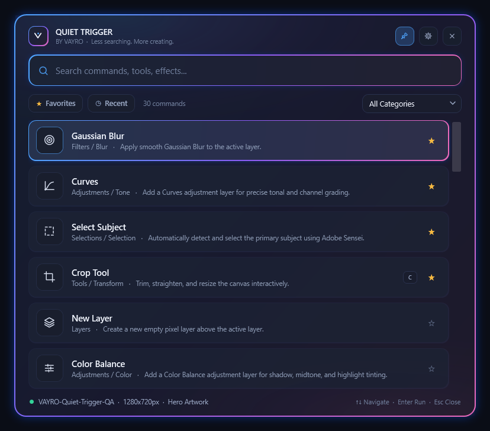
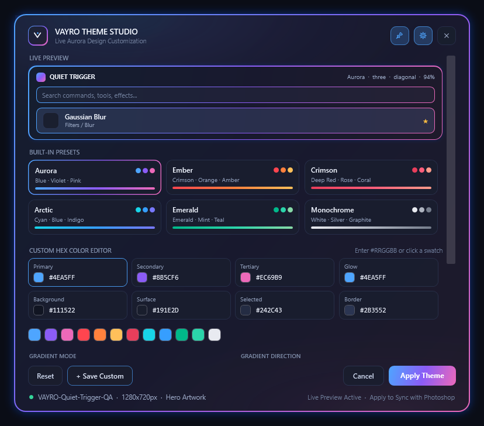

<p align="center">
  
</p>

# VAYRO

## Quiet Trigger

**A keyboard-driven command palette for Adobe Photoshop.**

*Less searching. More creating.*

**Quiet Trigger** is a fast, customizable command palette built by **VAYRO** for **Adobe Photoshop 2025** (UXP Manifest v5, Photoshop API v2). It pairs a frosted floating Windows palette (`Ctrl + Alt + Space`) with a synchronized Photoshop UXP panel, **VAYRO Theme Studio**, a silent Windows system tray helper, and an authenticated local loopback bridge.

---

## Product Screenshots (v2.1.0 · Adobe Photoshop 2025 v26.8.1)

| Floating Palette — Aurora (`Ctrl + Alt + Space`) | VAYRO Theme Studio (Live Preview & 6 Presets) |
|---|---|
|  |  |

| Floating Palette — Ember Preset | Floating Palette — Custom Red/Orange Theme |
|---|---|
|  |  |

---

## Installation Options

Download official verified artifacts from the [v2.1.0 GitHub Release](https://github.com/erf81/vayro-quiet-trigger/releases/tag/v2.1.0):

| Artifact | What It Installs | Recommended For |
|---|---|---|
| **`VAYRO-Quiet-Trigger-Setup-2.1.0-x64.exe`** | **Quiet Trigger Setup** *(Published by VAYRO)* — complete per-user installer bundling the Photoshop UXP `.ccx`, silent tray helper (`QuietTriggerHelper.exe`), portable Node.js bridge runtime, floating WPF palette, automatic startup, and uninstaller | **All Windows 10/11 Photoshop users** |
| **`VAYRO-Quiet-Trigger-Photoshop-2.1.0.ccx`** | Official Adobe Photoshop UXP plugin package only (docked panel inside Photoshop; global floating palette requires the Windows installer) | Users who only want the docked Photoshop panel |

1. Download **`VAYRO-Quiet-Trigger-Setup-2.1.0-x64.exe`** and verify its SHA-256 hash against `checksums.txt`.
2. Run **Quiet Trigger Setup** (per-user install — no administrator prompt, no global Node.js, AutoHotkey, or UXP Developer Tool required).
3. Open **Adobe Photoshop 2025** and press **`Ctrl + Alt + Space`**.

> **Code Signing Notice**: Initial public builds are unsigned (no commercial Authenticode certificate). Verify SHA-256 checksums before running the installer. See [docs/INSTALLATION.md](docs/INSTALLATION.md) and [docs/UPGRADE.md](docs/UPGRADE.md).

---

## Key Features
- **98 Photoshop Commands Across 8 Categories** (`Tools`, `Filters`, `Adjustments`, `Layers`, `Selections`, `Document`, `View`, `Export`) — **92 / 98 live-verified PASS** in Adobe Photoshop 2025 v26.8.1 ([docs/COMMAND_REFERENCE.md](docs/COMMAND_REFERENCE.md)).
- **Instant Local Fuzzy + English + Persian Search**: Partial-word (`gblr`), alias (`usm`, `crv`), keyword, and Persian (Farsi) queries (`بلور`, `ماسک`, `کراپ`, `منحنی`), plus pinned **Favorites** and **Recent Commands**.
- **Document & Layer Awareness**: Live Photoshop document name, dimensions, active layer kind/lock state, pre-flight guards, and destructive action confirmations.
- **VAYRO Theme Studio**: 6 built-in presets (**Aurora**, **Ember**, **Crimson**, **Arctic**, **Emerald**, **Monochrome**), 8-token validated `#RRGGBB` HEX editor, Solid / 2-Color / 3-Color gradients & directions, Glow, Surface Style, Opacity (`0.72–1.00`), Corner Radius, UI Density, Dark/Light/Auto appearance, Saved Custom Themes, and real-time UXP ↔ WPF sync ([docs/THEME_STUDIO.md](docs/THEME_STUDIO.md)).
- **Silent Windows Background Helper & System Tray**: Auto-starts cleanly at Windows sign-in (`HKCU\...\Run`), stays silent in the system tray, activates **only** when Adobe Photoshop is focused (`Ctrl + Alt + Space` default; optional `Ctrl + Space` override with Photoshop Zoom warning), and uninstalls cleanly while preserving user settings by default.

---

## Repository Architecture

```text
vayro-quiet-trigger/
├── photoshop-plugin/        # Official Adobe Photoshop UXP package root (Manifest v5, API v2)
│   ├── manifest.json        # Preserved internal ID: com.zau.photoshop.console
│   ├── index.html / index.js / styles.css
│   └── src/                 # bridge, commands (98), core, search, storage, theme, ui
├── companion/               # Windows desktop companion application
│   ├── tray/                # Silent native WinExe system tray & hotkey host (QuietTriggerHelper.cs)
│   ├── windows-helper/      # Frosted WPF floating palette (quiet-trigger-palette.ps1) & legacy scripts
│   └── bridge/              # Loopback-only authenticated WebSocket/HTTP bridge (127.0.0.1:47821)
├── installer/               # Inno Setup 6 single-file installer (quiet-trigger.iss) & UPIA scripts
├── assets/
│   ├── brand/vayro/         # Parent brand (VAYRO) marks & horizontal lockups
│   ├── brand/quiet-trigger/ # Product (Quiet Trigger) icon, wizard bitmaps & social preview
│   └── icons/               # Photoshop UXP Manifest v5 @1x/@2x chrome & pluginList icons
├── scripts/                 # build/, release/, and security/ tooling
├── tests/                   # unit/ (23 tests), integration/ (5 tests), fixtures/
└── docs/                    # Architecture, branding, ecosystem, installation, upgrade & test reports
```

---

## Platform, Security & Known Limitations
- **Photoshop Compatibility**: Live-verified on Windows 10 Enterprise x64 + **Adobe Photoshop 2025 v26.8.1** (UXP Manifest v5, API v2, minVersion `24.0.0`).
- **Security**: Strictly loopback-only (`127.0.0.1:47821`), 256-bit constant-time session token authentication, automatic user-private pairing, zero telemetry, and full Git-history Gitleaks secret scanning ([SECURITY.md](SECURITY.md)).
- **Known Limitations (6 / 98 commands)**: 4 full-screen GPU workspaces (`Lens Blur`, `Field Blur`, `Liquify`, `Camera Raw`) require interactive OK/Cancel inside Photoshop's GPU UI; 2 Adobe Sensei AI commands (`Select Subject`, `Remove Background`) depend on active Adobe cloud authentication and recognizable subjects.

---

## Development & Testing
```bash
npm test                # Run all 28 unit & integration tests
npm run icons           # Regenerate UXP & brand assets
npm run package         # Build Photoshop UXP .ccx from photoshop-plugin/
npm run build:helper    # Compile companion/tray/QuietTriggerHelper.cs
npm run build:installer # Build single-file Windows installer + checksums.txt
npm run security:scan   # Run full Git-history & working-tree Gitleaks scan
```

---

## Documentation
- [docs/INSTALLATION.md](docs/INSTALLATION.md) — Install, verify checksums & uninstall
- [docs/UPGRADE.md](docs/UPGRADE.md) — Safe upgrade from ZAU Console 2.0.0
- [docs/ARCHITECTURE.md](docs/ARCHITECTURE.md) — Plugin, companion, bridge & installer architecture
- [docs/THEME_STUDIO.md](docs/THEME_STUDIO.md) — VAYRO Theme Studio presets & live sync
- [docs/BRANDING.md](docs/BRANDING.md) — VAYRO & Quiet Trigger brand hierarchy & naming review
- [docs/ECOSYSTEM.md](docs/ECOSYSTEM.md) — VAYRO multi-product repository & release conventions
- [docs/COMMAND_REFERENCE.md](docs/COMMAND_REFERENCE.md) — 98-command verification matrix
- [docs/TEST_REPORT.md](docs/TEST_REPORT.md) — Automated (28/28) & live Windows 10 + Photoshop 2025 QA evidence
- [CONTRIBUTING.md](CONTRIBUTING.md) · [SECURITY.md](SECURITY.md) · [CHANGELOG.md](CHANGELOG.md) · [TRADEMARKS.md](TRADEMARKS.md) · [THIRD_PARTY_NOTICES.txt](THIRD_PARTY_NOTICES.txt)

---

## License & Trademark Notice

### Source Code License — Apache License 2.0
**Copyright 2026 erf81** — Original source code is licensed under the **Apache License, Version 2.0** (see [LICENSE](LICENSE) and [NOTICE](NOTICE)).

### Third-Party Components
Bundled installer runtimes (portable **Node.js v24.20.0** under MIT License; **Inno Setup 6.7.3** under Inno Setup License) remain subject to their respective upstream licenses and are not covered by `erf81`'s copyright or Apache-2.0. See [THIRD_PARTY_NOTICES.txt](THIRD_PARTY_NOTICES.txt).

### Trademark & Brand Notice
**VAYRO** and **Quiet Trigger** are names used to identify this project. The Apache License 2.0 applies to the project's source code and does not grant permission to use these names, logos, or visual identity in a way that suggests official affiliation or endorsement. Forks and modified distributions should use their own names and branding. This notice does not claim trademark registration or establish exclusive trademark rights. See [TRADEMARKS.md](TRADEMARKS.md).
