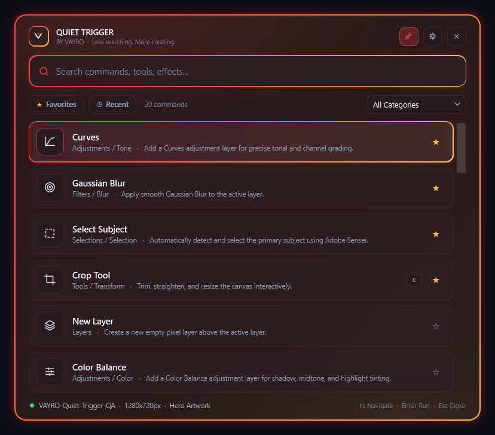
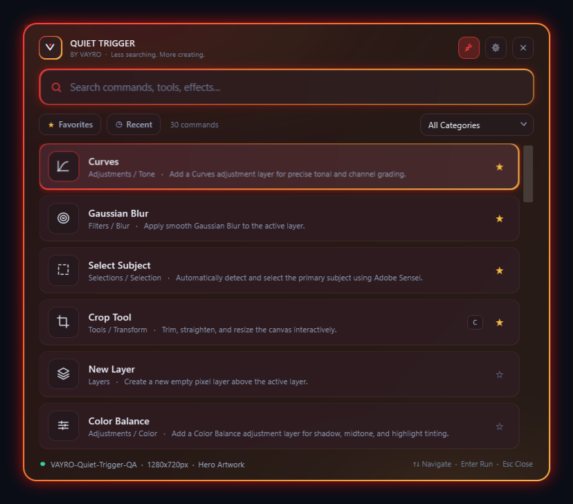

<p align="center">
  
</p>

# Quiet Trigger by VAYRO

**"Less searching. More creating."**

**Quiet Trigger** is a fast, customizable, keyboard-driven command palette for **Adobe Photoshop** built by **VAYRO**. Inspired by instant command-launcher workflows and engineered natively for **Adobe Photoshop 2025** (UXP Manifest v5, Photoshop API v2), it pairs a frosted floating Windows palette (`Ctrl + Alt + Space`) with a synchronized Photoshop UXP panel, an authenticated local loopback bridge, and **VAYRO Theme Studio**.

---

## Live Screenshots (v2.1.0 · Adobe Photoshop 2025 v26.8.1)

| Floating Palette — Aurora (`Ctrl + Alt + Space`) | VAYRO Theme Studio (Live Preview & 6 Presets) |
|---|---|
|  |  |

| Floating Palette — Ember Preset | Floating Palette — Custom Red/Orange Theme |
|---|---|
|  |  |

---

## Main Features
- **One-Click Single-File Windows Installer**: Download `VAYRO-Quiet-Trigger-Setup-2.1.0-x64.exe` — bundles the official Photoshop UXP `.ccx`, silent background tray helper (`QuietTriggerHelper.exe`), portable Node.js runtime, loopback bridge, floating WPF palette, automatic Windows startup, and clean uninstaller. No global Node.js, AutoHotkey, or developer tools required.
- **Silent Windows Background Helper & System Tray**: Starts automatically at Windows sign-in with zero command prompt windows, stays quiet in the system tray (`Open Quiet Trigger`, `Theme Studio`, `Settings`, `Pause Hotkey`, `Resume Hotkey`, `Start Photoshop`, `Check for Updates`, `Exit Quiet Trigger`), and only activates when Adobe Photoshop is the foreground window.
- **98 Photoshop Commands Across 8 Categories**: `Tools`, `Filters`, `Adjustments`, `Layers`, `Selections`, `Document`, `View`, and `Export` — **92 / 98 live-verified PASS** in Adobe Photoshop 2025 v26.8.1 (with the remaining 6 GPU-workspace / Adobe Sensei commands transparently documented).
- **Instant Local Fuzzy + English + Persian Search**: Partial-word (`gblr`), alias (`usm`, `crv`), keyword, and Persian (Farsi) queries (`بلور`, `ماسک`, `کراپ`, `منحنی`), plus pinned **Favorites**, **Recent Commands**, and category filtering.
- **Document & Layer Awareness**: Live Photoshop document name, dimensions, active layer kind/lock state, pre-flight guards, and destructive action confirmations.
- **VAYRO Theme Studio**: 6 built-in presets (**Aurora**, **Ember**, **Crimson**, **Arctic**, **Emerald**, **Monochrome**), 8-token validated `#RRGGBB` HEX editor, Solid / 2-Color / 3-Color gradients & directions, Glow, Surface Style, Opacity (`0.72–1.00`), Corner Radius, UI Density, Dark/Light/Auto appearance, Saved Custom Themes, and live bidirectional UXP ↔ WPF synchronization without restarting Photoshop.

---

## One-Click Installation

Two official release artifacts are provided in `dist/`:

| Artifact | Purpose | Recommended For |
|---|---|---|
| **`VAYRO-Quiet-Trigger-Setup-2.1.0-x64.exe`** | Complete Windows installer (UXP plugin + silent tray helper + bundled Node.js bridge + auto-startup + uninstaller) | **All Windows Photoshop users** |
| **`VAYRO-Quiet-Trigger-Photoshop-2.1.0.ccx`** | Official Adobe Photoshop UXP plugin package only (docked panel only; no global floating palette) | Users who only want the Photoshop panel |

1. Download **`VAYRO-Quiet-Trigger-Setup-2.1.0-x64.exe`** and verify its SHA-256 hash against [dist/checksums.txt](dist/checksums.txt).
2. Run the installer (per-user install — no administrator elevation required).
3. Open **Adobe Photoshop 2025** and press **`Ctrl + Alt + Space`**.

> **Unsigned Staging Build Notice**: This release is not yet signed with a paid Authenticode certificate. Windows SmartScreen may show an "Unknown publisher" notice — verify the SHA-256 checksum before proceeding. See [docs/INSTALLATION.md](docs/INSTALLATION.md) for full instructions.

---

## Photoshop Compatibility
- **Live-Verified Host**: **Adobe Photoshop 2025 v26.8.1** (Windows 10 Enterprise x64)
- **UXP Target**: Manifest v5, Photoshop API v2, minimum host version `24.0.0`
- **Installation Method**: Official Adobe `UnifiedPluginInstallerAgent.exe /install` (with fallback to official `.ccx` Creative Cloud Desktop file association if UPIA is absent). Never copies files manually into Adobe plugin folders.

---

## Global Hotkey
- **Default**: **`Ctrl + Alt + Space`** (safe default; preserves Photoshop's native `Ctrl + Space` temporary Zoom In shortcut).
- **Optional Override**: **`Ctrl + Shift + Space`** or **`Ctrl + Space`** (displays an explicit warning about replacing Photoshop's native Zoom In while Quiet Trigger is active).
- Configurable anytime via **System Tray → Settings** or **Photoshop Panel → Settings**.
- Hotkey fires **only** when `Photoshop.exe` is the active foreground window and can be paused/resumed from the system tray.

---

## VAYRO Theme Studio & Custom Themes
Click the **Gear (`⚙`)** button in either the floating palette or the Photoshop UXP panel (or **System Tray → Theme Studio**) to open **VAYRO Theme Studio**:
- **6 Presets**: Aurora *(default Blue → Violet → Pink)*, Ember, Crimson, Arctic, Emerald, Monochrome.
- **Custom Themes**: Edit all 8 color tokens with validated `#RRGGBB` inputs or quick swatches, customize 1/2/3-color gradients & directions, adjust glow, surface style, opacity, corner radius, and density, preview live in miniature, save up to 12 custom theme chips, and sync live across WPF and Photoshop UXP with zero restart.

See [docs/THEME_STUDIO.md](docs/THEME_STUDIO.md) for exact preset palettes and schema details.

---

## Command Categories (98 Commands)
1. **Tools** — Move, Brush, Crop, Selection, Healing, Clone, Pen, Type, Shape, Zoom, Hand, and more.
2. **Filters** — Gaussian Blur, Motion Blur, Lens Blur, Surface Blur, Blur Gallery, Smart Sharpen, Unsharp Mask, High Pass, Noise, Liquify, Camera Raw.
3. **Adjustments** — Curves, Levels, Hue/Saturation, Color Balance, Vibrance, Brightness/Contrast, Exposure, Black & White, Gradient Map, Channel Mixer, Selective Color.
4. **Layers** — New, Duplicate, Delete, Group/Ungroup, Layer Mask, Clipping Mask, Smart Object, Rasterize, Merge, Flatten, Lock, Rename.
5. **Selections** — Select All, Deselect, Inverse, Feather, Expand, Contract, Smooth, Select Subject, Remove Background.
6. **Document** — New, Image Size, Canvas Size, Trim, Crop, Rotate, Flip, New Guide Layout.
7. **View** — Fit on Screen, 100% Actual Pixels, Zoom In/Out, Guides, Rulers, Grid.
8. **Export** — Quick Export PNG, Export As, Export JPEG, Save a Copy, Export Selected Layers.

Full live-verification status for every command is documented in [docs/COMMAND_REFERENCE.md](docs/COMMAND_REFERENCE.md).

---

## Security & Local Loopback Bridge
- Binds **strictly to `127.0.0.1:47821`** (never exposes a public network port).
- Authenticates every HTTP and WebSocket request with a **256-bit random per-user session token** checked via constant-time `crypto.timingSafeEqual`.
- Automatic local first-run pairing operates strictly within the logged-in Windows user's private `%LOCALAPPDATA%` and `%APPDATA%` directories.
- No session tokens are bundled in the installer, logged to stdout, or stored inside `theme.json`.
- Theme synchronization (`POST /theme`) never triggers Photoshop command execution.

See [SECURITY.md](SECURITY.md) for full security architecture details.

---

## Upgrade & Uninstallation
- **Upgrading from ZAU Console 2.0.0**: Run `VAYRO-Quiet-Trigger-Setup-2.1.0-x64.exe` directly. It preserves internal UXP ID `com.zau.photoshop.console` (zero duplicate plugin), backs up and restores Photoshop `PluginData`, and atomically migrates your existing session token, custom themes, Favorites, and Recents. See [docs/UPGRADE.md](docs/UPGRADE.md).
- **Uninstalling**: Open **Windows Settings → Apps → Installed Apps → Quiet Trigger by VAYRO → Uninstall**. Stops the helper and bundled bridge, removes startup entries and shortcuts, offers optional official UPIA plugin removal, and **preserves your user settings and themes by default**.

---

## Development Setup & Testing
```bash
npm test            # Run all 28 automated unit & integration tests
npm run icons       # Regenerate Photoshop UXP & VAYRO brand assets
npm run package     # Build dist/VAYRO-Quiet-Trigger-Photoshop-2.1.0.ccx
npm run build:helper    # Compile installer/build/QuietTriggerHelper.exe (.NET Framework 4.x)
npm run build:installer # Build dist/VAYRO-Quiet-Trigger-Setup-2.1.0-x64.exe + checksums.txt
```
See [docs/TEST_REPORT.md](docs/TEST_REPORT.md) for complete automated (28/28) and live Photoshop 2025 v26.8.1 verification evidence.

---

## Known Limitations
- **92 / 98 commands** are fully live-verified PASS in Adobe Photoshop 2025 v26.8.1. The remaining **6 commands** are explicitly documented:
  - **4 full-screen GPU workspaces** (`filter.lensBlur`, `filter.blurGalleryField`, `filter.liquify`, `filter.cameraRaw`) require manual interactive OK/Cancel inside Photoshop's modal GPU workspace.
  - **2 Adobe Sensei AI commands** (`selection.selectSubject`, `selection.removeBackground`) depend on active Adobe Creative Cloud authentication and recognizable image subjects.
- Windows floating palette and global hotkey helper target **Windows 10/11 x64**. The Photoshop UXP `.ccx` panel itself follows standard Photoshop UXP Manifest v5 API v2.
- Current staging installer binaries are unsigned (SHA-256 checksums provided).

---

## Documentation Index
- [docs/INSTALLATION.md](docs/INSTALLATION.md) — Complete installation & uninstall guide
- [docs/UPGRADE.md](docs/UPGRADE.md) — Upgrading safely from ZAU Console 2.0.0
- [docs/THEME_STUDIO.md](docs/THEME_STUDIO.md) — VAYRO Theme Studio presets & customization
- [docs/BRANDING.md](docs/BRANDING.md) — VAYRO & Quiet Trigger brand architecture & preliminary name review
- [docs/COMMAND_REFERENCE.md](docs/COMMAND_REFERENCE.md) — 98-command verification matrix
- [docs/TEST_REPORT.md](docs/TEST_REPORT.md) — Automated (28/28) & live Windows 10 + Photoshop 2025 test evidence
- [SECURITY.md](SECURITY.md) — Local bridge security model & third-party notices
- [CHANGELOG.md](CHANGELOG.md) — Full version history (`2.1.0`, `2.0.0`, `1.0.0`)

---

## License Status
**Unlicensed (All Rights Reserved — Pending Owner Decision).**
No open-source or commercial license has been selected yet for **Quiet Trigger by VAYRO**. This repository is maintained as a private staging repository until an explicit license is chosen by the owner. Bundled third-party components (such as the portable Node.js runtime) retain their respective upstream licenses; see [installer/THIRD_PARTY_NOTICES.txt](installer/THIRD_PARTY_NOTICES.txt).
