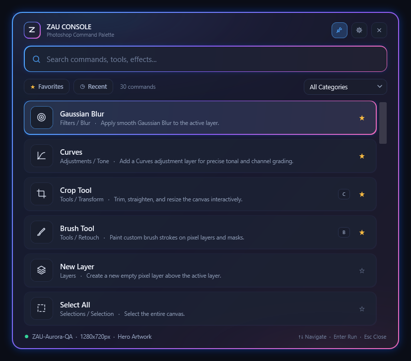
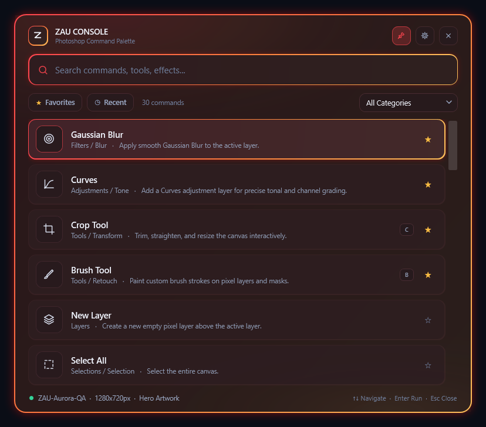
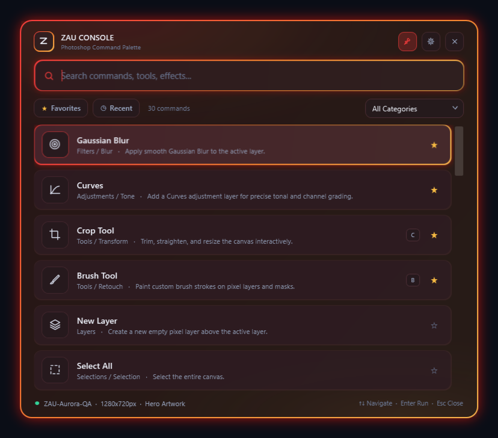
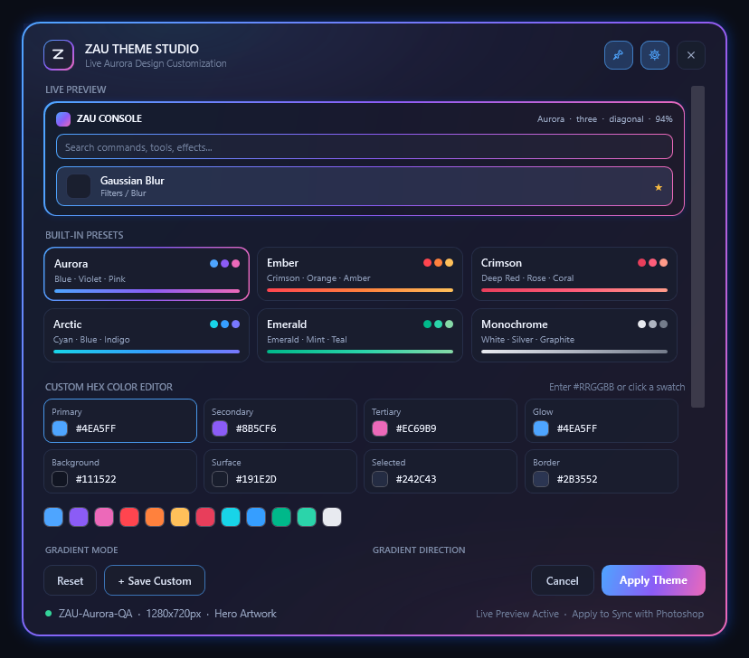
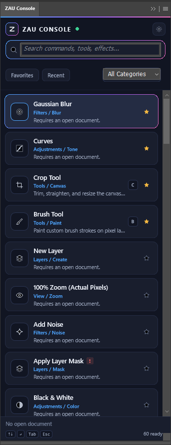
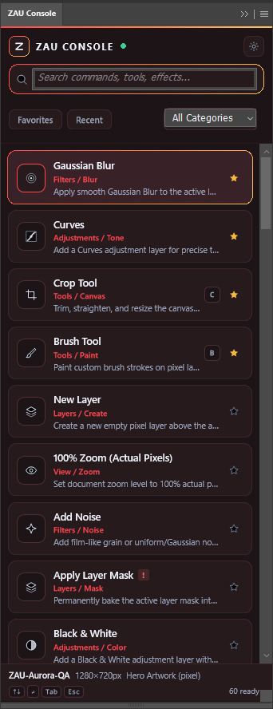
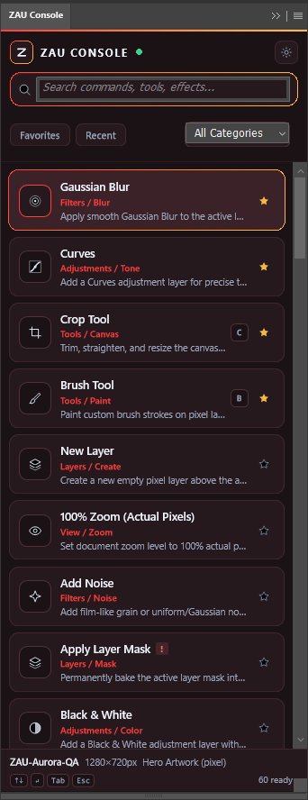

# ZAU Console 2.0 — ZAU Aurora Design System & Theme Studio

**ZAU Theme Studio** lets creative professionals customize the complete color, gradient, glow, translucency, corner radius, density, and appearance system of **ZAU Console 2.0** in real time — without restarting Adobe Photoshop — across both the **Photoshop UXP docked panel** and the **Windows WPF floating palette**.

---

## Live Previews (Adobe Photoshop 2025 v26.8.1 & Windows WPF)

| WPF Floating Palette — Aurora | WPF Floating Palette — Ember |
|---|---|
|  |  |

| WPF Floating Palette — Custom Red/Orange | WPF Built-in ZAU Theme Studio |
|---|---|
|  |  |

| Photoshop UXP Panel — Aurora | Photoshop UXP Panel — Ember (Live Sync) | Photoshop UXP Panel — Custom Red/Orange |
|---|---|---|
|  |  |  |

---

## 1. Built-in Presets (6 Signature Themes)

All 6 presets are defined in the shared schema (`src/theme/themeSystem.js`) and mirrored identically in `hotkey-helper/zau-palette.ps1`:

| Preset | Subtitle | Primary | Secondary | Tertiary | Background | Surface | Selected | Border | Glow |
|---|---|---|---|---|---|---|---|---|---|
| **Aurora** *(default)* | Blue · Violet · Pink | `#4EA5FF` | `#8B5CF6` | `#EC69B9` | `#111522` | `#191E2D` | `#242C43` | `#2B3552` | `#4EA5FF` |
| **Ember** | Crimson · Orange · Amber | `#FF454F` | `#FF813D` | `#FFC05A` | `#1D1417` | `#271A1D` | `#382127` | `#4E2E35` | `#FF5B45` |
| **Crimson** | Deep Red · Rose · Coral | `#E83E5B` | `#FF5E7A` | `#FF9B8A` | `#191318` | `#251A22` | `#38212E` | `#4E2C40` | `#E83E5B` |
| **Arctic** | Cyan · Blue · Indigo | `#18D4E8` | `#369EFF` | `#7878FF` | `#101921` | `#17232D` | `#203443` | `#2A465C` | `#18D4E8` |
| **Emerald** | Emerald · Mint · Teal | `#00B88A` | `#2BD4AA` | `#86D9A7` | `#111B19` | `#182521` | `#203A31` | `#2B4E42` | `#00B88A` |
| **Monochrome** | White · Silver · Graphite | `#E8EAF0` | `#AEB4C0` | `#747C8B` | `#141519` | `#202126` | `#30323A` | `#40434E` | `#D6DAE4` |

---

## 2. Customization Controls

Open **ZAU Theme Studio** by clicking the **Gear (`⚙`)** button in either the Photoshop UXP panel or the Windows WPF floating palette.

- **Live Miniature Preview**: Displays an instant live preview of the outer gradient frame, search bar, and selected command row as you tweak any setting.
- **Custom HEX Color Editor (8 Tokens)**: Edit `Primary`, `Secondary`, `Tertiary`, `Glow`, `Background`, `Surface`, `Selected`, and `Border` using validated `#RRGGBB` / `#RGB` inputs or clickable quick swatches (UXP-safe — does not rely on unsupported `<input type="color">`).
- **Gradient Customization**:
  - **Mode**: `Solid` (single-color accent), `2-Color` (`Primary → Secondary`), or `3-Color` (`Primary → Secondary → Tertiary`).
  - **Direction**: `Horizontal`, `Diagonal`, or `Vertical`.
- **Visual Effects & Layout**:
  - **Glow Intensity**: `Off`, `Low`, `Medium`, `High`.
  - **Surface Style**: `Frosted`, `Translucent`, `Solid`, `Flat`.
  - **Floating Window Opacity**: `0.72` to `1.00` (clamped safely to preserve readability).
  - **Corner Radius**: `12px`, `16px`, `20px`, `24px`.
  - **UI Density**: `Compact`, `Comfortable`, `Spacious`.
  - **Appearance**: `Dark`, `Light`, or `Auto` (UXP `auto` adapts across all 4 native Photoshop `prefers-color-scheme` modes).
- **Actions**:
  - **Apply Theme**: Persists the theme and pushes live synchronization to the paired surface.
  - **Save Custom**: Saves up to 12 named custom theme chips for one-click reuse.
  - **Reset**: Restores the default **Aurora** theme without touching Favorites, Recent Commands, or Bridge settings.
  - **Cancel**: Discards draft edits and restores the previous committed theme cleanly.

---

## 3. Shared Schema, Persistence & Bidirectional Sync

- **UXP Storage**: Saved in Photoshop's plugin data folder (`zau-console-state.json`) under `auroraTheme` and `savedCustomThemes`.
- **WPF / Bridge Storage**: Saved in `%LOCALAPPDATA%\ZAU-Console\zau-theme.json`.
- **Authenticated Loopback Sync**:
  - `GET http://127.0.0.1:47821/theme` (requires `X-ZAU-Token`).
  - `POST http://127.0.0.1:47821/theme` (requires `X-ZAU-Token`) — validates and sanitizes the theme, persists `zau-theme.json`, and pushes a `{ type: "themeUpdate" }` frame to Photoshop UXP over the existing singleton WebSocket connection.
- **Security Guarantees**:
  - Theme updates **never** trigger Photoshop command execution.
  - `bridgeToken` and session credentials are **never** stored inside `auroraTheme` or `zau-theme.json` (stripped by `sanitizeTheme()`).
  - The local bridge remains strictly bound to `127.0.0.1` with constant-time 256-bit token authentication.
